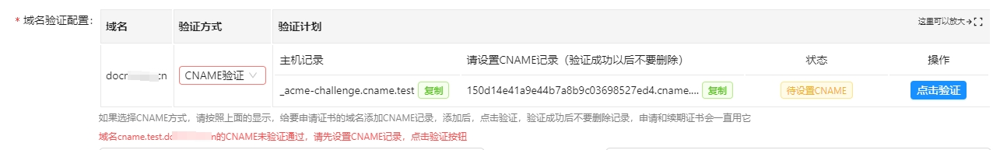

# CNAME 代理验证

当 Certd 无法直接操作申请域名的 DNS 时，可以先手动添加 CNAME，再让 Certd 在可管理的代理域名下自动写入 TXT。整个流程只需要手动配置一次 CNAME，后续续期可复用。

以申请 `example.com` 为例，假设 Certd 生成的代理目标是 `id.validation.example.net`。

| 写入位置 | 记录类型 | 操作 |
| --- | --- | --- |
| `_acme-challenge.example.com` | CNAME | 在申请域名的 DNS 中添加，目标填 `id.validation.example.net`。 |
| `id.validation.example.net` | TXT | Certd 在签发或续期时自动写入用来验证的值。 |

## 配置单个域名

1. 新建证书流水线，填入申请的域名并选择 **CNAME 代理验证**。
2. 打开验证计划，选择可用的 **CNAME 服务**。可以使用实例提供的公共服务。自托管实例的管理员也可在 **系统管理 → CNAME服务设置** 配置自有的代理域名和 DNS 授权。
3. 按 Certd 显示的 **主机记录** 和 CNAME 目标，到申请域名的 DNS 控制台创建记录。使用 Cloudflare 时将这条验证 CNAME 设为仅 DNS。
4. 回到 Certd 点击 **验证**。成功后保存和运行流水线，保留 CNAME，供以后续期。

## 批量导入和导出

1. 打开 **设置 → CNAME记录管理 → 批量导入**，确认 CNAME 服务，每行填一个域名。泛域名去掉 `*.` 前缀，已有记录会被跳过。
2. 生成记录后选择 **批量导出**，按 DNS 服务商支持的格式导入记录，或依据表格逐条添加。
3. 回到 Certd 验证记录。申请任务会查找对应域名中已验证的 CNAME 记录。

## 排查验证失败

- **记录未生效。** 检查当前权威 DNS、主机记录和目标地址。DNS 控制台如果会自动补全域名，只填写主机名前缀。
- **主域名与配置不一致。** 如果创建流水线后改过子域名托管，在 CNAME 记录列表重置校验状态并重新验证，然后重新保存申请任务的验证计划。
- **日志显示找不到目标 TXT。** 先确认 CNAME 跳转正确，再检查目标 DNS 授权和 TXT 的传播情况。详见 [DNS 验证排错](../../use/cert/validation.md#排查-dns-验证失败)。
