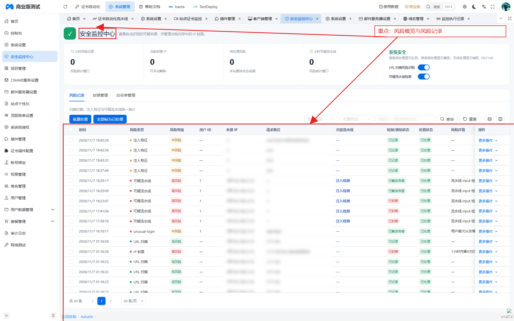

# 站点安全

Certd 会保存证书私钥和部署授权等敏感信息。部署后请设置独立的管理员密码，通过 HTTPS 访问，并定期备份数据。需要限制站点访问时，可在「系统管理 → 系统设置 → 安全设置」开启站点隐藏。[站点隐藏](./hidden/) · [数据库备份](../../use/backup/)

## 账号与授权

授权的敏感字段会加密存储，账号密码以哈希保存。多次登录失败可能触发临时锁定，管理员可结合账号状态和操作日志排查。

### 登录双重验证

1. 在个人设置中进入「安全设置」，启用验证器。
2. 用验证器应用扫描二维码，或手动输入界面给出的密钥。输入当前验证码完成绑定。
3. 开启「登录二次验证」。保留当前会话，在另一个窗口确认能用密码和验证码登录。

启用验证器后，查看加密授权字段时可能要求再次输入验证器代码。关闭登录二次验证或关闭验证器时，需要验证当前登录密码。如果正确的验证码持续失败，先确认手机和服务器时间准确，再确认验证器选择了对应站点的账号。

### 登录验证码

管理员在「系统管理 → 系统设置 → 验证码」选择图片验证码、极验、腾讯云验证码或 Cloudflare Turnstile。使用外部服务时先按配置表单填入对应站点密钥，再用同一页面的测试入口完成验证并保存。Turnstile 测试失败时，检查小组件授权的站点域名、浏览器是否能加载验证码，以及 Certd 服务端是否可访问验证服务。

管理员重置密码时，系统会一并关闭登录验证码。重新登录后可配置并测试验证码，再开启。[无法登录时的恢复步骤](../../use/forgotpasswd/)

## 安全监控中心

有系统设置查看权限的管理员可前往「系统管理 → 安全监控中心」。普通版可查看摘要，专业版还可查看风险详情、修改检测设置、处理风险和管理封禁及白名单。

概览显示最近 72 小时的风险数和可疑流水线数，以及当前封禁 IP 和待处理风险数。高危待处理显示红色，其他待处理显示黄色，无待处理显示绿色。

### 检测和处置

检测设置中可分别启用「URL 扫描风险识别」和「可疑流水线检测」，两项默认开启。开关只影响后续检测，历史记录和已有封禁会保留。修改需要系统设置编辑权限。

| 风险 | 系统行为 |
| --- | --- |
| 可疑流水线 | 保存时检查标题、内容和插件输入，命中后记录风险并尝试向管理员发邮件 |
| URL 扫描或注入特征 | 记录匹配的风险，扫描记录仍可在安全监控中心查看 |

从 v1.47.2 起，扫描达到频次阈值时的自动 IP 封禁暂时关闭。URL 风险检测和手动封禁仍可用。可疑流水线告警也由管理员核实和处置。合法脚本可能匹配检测特征，请结合任务用途和用户操作判断。

1. 在「风险记录」按类型、等级、处置状态或关键字定位记录。
2. 检查关联 IP、用户、流水线和原因。需要限制访问或运行时，从记录操作或「封禁管理」添加规则。
3. 在单条记录菜单标记处置状态，或勾选记录后点「批量设置处置状态」。使用「全部标为已处理」前，检查确认框列出的范围。

管理员告警依赖 [站点邮箱配置](../../use/email/) 和管理员邮箱。扫描风险可在监控中心查看。管理员可在「系统管理 → 审计日志」核查操作。有编辑权限时可清理 90 天前的审计日志。

### 封禁与白名单

在「封禁管理 → 手动添加封禁」选择目标和限制范围。IP 可限制访问。用户可选择限制访问和运行，或仅限制运行。按流水线 ID 添加时仅限制该流水线。需要自动解除时填到期时间，留空则需手动解除。

被封禁的访问请求可能返回 404。遇到误封时，由有权限的管理员在「封禁管理」解除对应规则。可信 IP 或用户可加入白名单以跳过 IP 访问封禁。账户权限、用户访问封禁和流水线运行限制仍按各自规则执行。反向代理部署时，先核对安全记录里的来源 IP。[代理与连通性排查](../../use/setting/network.md)

## 非常用 IP 登录提醒

专业版根据用户过去 30 天的成功审计记录识别常用 IP。没有近期记录时，使用最后一条成功记录的 IP。首次登录没有可用记录时跳过比较。

警告会写入该用户的「操作日志」，并优先通过默认通知渠道发送。未配置默认渠道时尝试发往账号邮箱，邮件发送依赖站点 SMTP。收到异常登录提醒后，核对操作时间与 IP。确认账号有异常时及时修改密码并检查相关授权。
