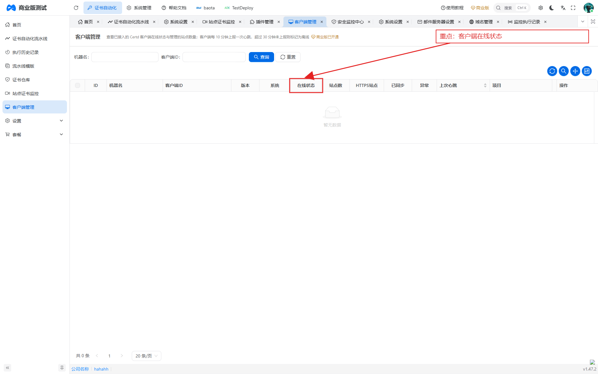

# Certd Client

Certd Client 运行在应用服务器上，发现 Nginx、Apache 或 IIS 的站点，从 Certd 拉取证书并部署。目标服务器需要能访问 Certd。

## 首次同步

1. 在要部署证书的主机上下载并运行客户端。运行账户需要能读取站点配置、写入证书文件并重载对应服务。[下载 Certd Client](https://github.com/certd/certd-client/releases)
2. 在客户端扫描应用和站点，确认域名和证书路径，禁用测试站点或由其他工具管理的站点。
3. 在 Certd 创建「仅开放接口」的 API 密钥，企业模式下先切换到目标项目。将实例地址、`KeyId` 和 `KeySecret` 填入客户端的「配置 Certd 接口」。
4. 选择「同步证书」。客户端处理启用的 HTTPS 站点。检查同步日志，并用浏览器或站点证书监控确认服务已提供新证书。
5. 在「定时执行」中配置计划并启动后台服务。[客户端完整说明](https://github.com/certd/certd-client)

## 查看接入状态

专业版可打开「客户端管理」，查看站点统计、异常数和最后心跳。客户端每 10 分钟上报一次，超过 30 分钟未上报会显示离线。

## 同步失败

- **站点未识别。** 检查应用是否启用、运行账户能否读取配置，以及站点是否配置 HTTPS。
- **接口请求失败。** 从客户端主机确认 Certd 地址可访问，再检查密钥、项目和系统时间。
- **证书拉取后部署失败。** 查看站点日志中的文件路径和权限，核对服务是否成功重载。需要证书密码时，确认对应 API 密钥已开启「返回证书密码」。
- **客户端离线。** 确认客户端或后台服务仍在运行，并检查到 Certd 的网络。
