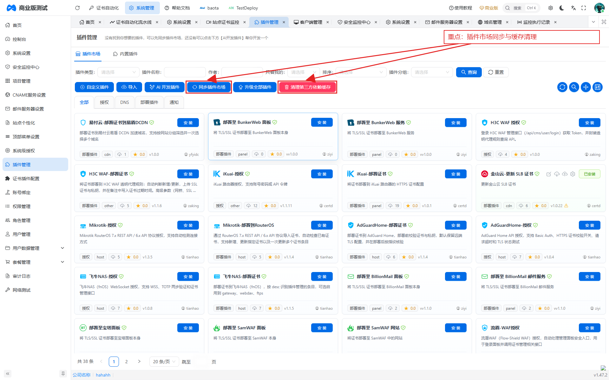

# 插件市场

在「系统管理 → 插件管理」查找内置和在线插件。安装在线插件后，按插件类型在流水线、授权或通知配置中使用。

## 安装和升级

1. 切换到「插件市场」，点击「同步插件市场」，按插件名或用途搜索。
2. 打开插件详情，确认版本、类型和专业版要求，点击安装。如果页面列出依赖，可先安装依赖再继续。
3. 在插件卡片打开「配置」，填写所需参数。部署任务通常还需要单独创建对应授权。
4. 已安装插件有新版本时可单独升级，也可点击「升级全部插件」。升级前确认现有任务依赖的配置，升级后用一条流水线验证。

## 找不到插件或任务失败

- **搜索不到。** 先同步市场，再检查分类和筛选条件。在线插件使用 `作者/名称` 区分同名条目。
- **安装依赖失败。** 检查 Certd 所在环境是否可访问 npm 镜像，再看任务日志。出现模块缺失或缓存异常时，可在「插件管理」清理第三方依赖缓存，重启 Certd 后重试。
- **准备卸载。** 先找出引用插件的流水线、授权或通知，替换或删除对应配置，再从插件卡片卸载。

[插件开发和发布](../use/dev/plugin.md)
