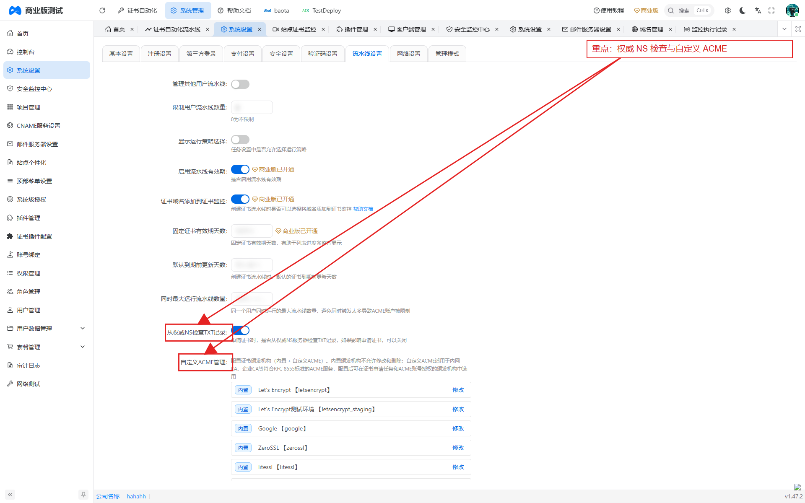

# ACME 账号、EAB 和自定义颁发机构

ACME 账号用于向所选证书颁发机构申请证书。关联同一账号的流水线可复用它。EAB 是部分颁发机构用于注册 ACME 账号的凭据，由 KID 和 HMAC Key 组成。

## 生成并使用 ACME 账号

1. 打开 **设置 → 授权管理**，新增类型为 **ACME账号** 的授权。
2. 选择 **证书颁发机构**，填入邮箱。颁发机构要求 EAB 时，填入它提供的 **EAB KID** 和 **EAB HMAC Key**。Google 凭据获取步骤见 [Google 证书申请](../google/index.md)。
3. 点击 **生成ACME账号** 并保存授权。回到申请任务，选择相同颁发机构和刚保存的 **ACME账号**。
4. 保留已有账号。只有需要更换账号或收到 EAB 失效、KID 变化等提示时，才在授权里开启 **修改ACME账号**，更新 EAB、重新生成后保存。使用 DNS 持久验证的流水线需要按新账号重新配置并验证 TXT。

## 添加自定义 ACME 颁发机构

1. 管理员进入 **系统设置 → 流水线设置 → 自定义ACME管理**，点击 **添加自定义ACME**。
2. 填写显示名称、唯一标识和 CA 提供的 **Directory URL**，例如 `https://ca.example.com/acme/directory`。如果颁发机构要求 EAB，启用对应选项。
3. 保存设置，用该机构生成新的 **ACME账号** 授权。
4. 在申请任务选择该自定义机构和对应账号，按 CA 支持的方式完成域名验证后运行。

如果账号生成失败，先从 Certd 所在网络检查 Directory URL 是否可达、其 HTTPS 证书是否受信任、所填 EAB 是否属于这家 CA。

## 反向代理地址迁移

升级时，Certd 会尝试把旧网络设置中的 ACME 反向代理搬到对应的内置颁发机构。升级后到 **系统设置 → 流水线设置 → 自定义ACME管理** 打开对应机构，确认 **反向代理地址**。只填代理域名，例如 `acme-proxy.example.com`，省略 `https://` 和路径。已有代理设置会保留，旧地址未迁入时可在对应机构补填。
