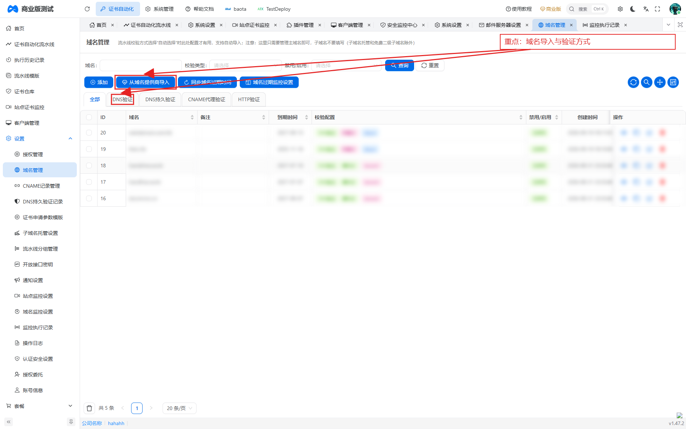

# 域名验证

颁发证书时，CA 会检查你是否控制申请的域名。根据 DNS 管理权限和站点入口选择验证方式。

| 验证方式 | 适用场景 |
| --- | --- |
| DNS 直接验证 | Certd 支持实际托管解析的服务商，且授权可以增删 TXT 记录。支持泛域名。 |
| 多 DNS 提供商 | 同一张证书包含多个域名，需要按域名配置不同的 DNS 提供商或验证方式。 |
| 自动选择 | 希望多条流水线复用 **域名管理** 中的验证配置。适合常用域名和 OpenAPI 自动申请。 |
| CNAME 代理验证 | 可以手动添加 CNAME，由公共或自建 CNAME 服务负责自动写入 TXT。详见 [CNAME 代理验证](../../feature/cname/index.md)。 |
| HTTP 文件验证 | 可以上传验证文件，且 CA 能访问公网 HTTP 80 端口。适用于具体域名或 IP。 |
| DNS 持久验证 | Certd 文档和管理入口以 Google 证书为准。保留与 ACME 账号绑定的 TXT 后可重复申请。详见 [Google DNS 持久验证](../google/index.md#dns-持久验证)。 |

## DNS 直接验证

1. 在 **设置 → 授权管理** 新建 DNS 授权，赋予目标 DNS 区域所需的记录读取、创建和删除权限。实际托管服务商可从域名的 NS 记录确认。
2. 打开申请任务，选择 **DNS 直接验证**，选择服务商和授权。需要按域名配置时选 **多 DNS 提供商**。
3. 保存并运行。Certd 会创建 `_acme-challenge` TXT，验证结束后清理本次创建的记录。

如果 DNS 区域单独托管在一个子域名下，请先设置 [二级子域名托管](./subdomain.md)。

## 自动选择与域名导入

1. 打开 **设置 → 域名管理**，为主域名添加记录。DNS 直接验证通常只维护主域名。单独托管的子域名按其实际 DNS 区域维护。
2. 在 **校验配置** 中设置校验类型、DNS 提供商类型与授权，或填写 HTTP 上传配置。CNAME 记录请在 **CNAME记录管理** 中维护并验证。
3. 将流水线申请任务的验证方式设为 **自动选择**，保存并运行。
4. 域名较多时，可在 **域名管理 → 从域名提供商导入** 添加并执行导入任务。已有域名会被跳过。导入后在流水线申请表单的域名下拉框选择导入的域名，并检查域名管理里的校验配置是否齐全。需要查看注册有效期时，在域名管理点击 **同步域名过期时间** 查看进度和结果。

## DNS 映射域名

映射域名适用于你已将 ACME 验证记录委派到另一 DNS 区域，并希望使用 DNS 直接验证的场景。以给 `example.com` 申请证书、由 Certd 在 `validation.example.net` 下写 TXT 为例。

1. 在 `example.com` 的权威 DNS 中手动添加 CNAME，把 `_acme-challenge.example.com` 指向 `_acme-challenge.validation.example.net`。
2. 在 **设置 → 域名管理** 编辑 `example.com`，将 **映射域名** 填为 `validation.example.net`。
3. 为验证配置选择能够在 `validation.example.net` 对应 DNS 区域增删记录的授权。直接在申请任务中指定授权时，也要选择目标区域的授权。
4. 保留 CNAME 并运行。日志会显示映射后的 TXT 写入位置，证书仍签给 `example.com`。申请其它子域名时，按该子域名实际的 `_acme-challenge` 名称配置 CNAME。

## HTTP 文件验证

1. 选择 **HTTP 文件验证**，为域名或 IP 打开 **验证计划**。目标站点应能从公网通过 HTTP 80 端口读取 `/.well-known/acme-challenge/` 下的文件。
2. 选择文件上传方式。使用 **SFTP/SCP** 时，先创建目标主机的 SSH 授权，再新增 **SFTP授权**，引用该 SSH 授权并选择实际上传协议。
3. 填写 **网站根路径**，例如 `/var/www/example.com`。Certd 会在这个根目录下创建 `.well-known/acme-challenge/` 并写入验证文件。
4. 排错时可用一个临时测试文件，从站点以外的网络访问相同路径。遇到 404 检查上传目录、虚拟主机和反向代理路由，遇到 403 检查文件读取权限和拦截规则。确认访问成功后清理测试文件。

## 排查 DNS 验证失败

- **无法写入 TXT。** 检查 DNS 授权是否能操作实际权威 DNS 区域。近期切换过 NS 时，尤其要确认新旧服务商和授权区域。
- **`NXDOMAIN` 或找不到 TXT。** 先从日志核对 Certd 写入的完整记录名。使用 CNAME 时检查源记录是否指向正确的目标，并检查目标 TXT 是否已生效。
- **等待解析超时。** 确认写入位置正确后，可调大 **等待解析生效时长**。如果日志确认 Certd 所在网络无法直查权威 NS，可由管理员在 **系统设置 → 流水线设置** 关闭 **从权威NS检查TXT记录**，让 Certd 使用本地解析器检查。颁发机构仍需要从公网解析记录。
- **CAA 或 DNSSEC 报错。** 核对 CAA 是否允许所选 CA，或请 DNS 管理员修复 DNSSEC 委派和签名。修改记录前先确认其它业务是否依赖它。
