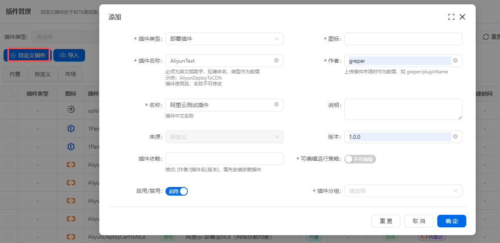
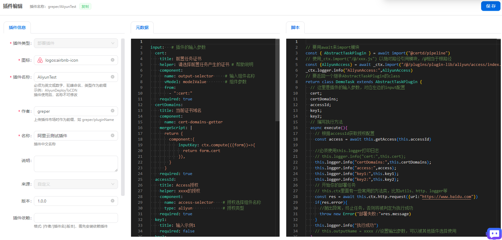
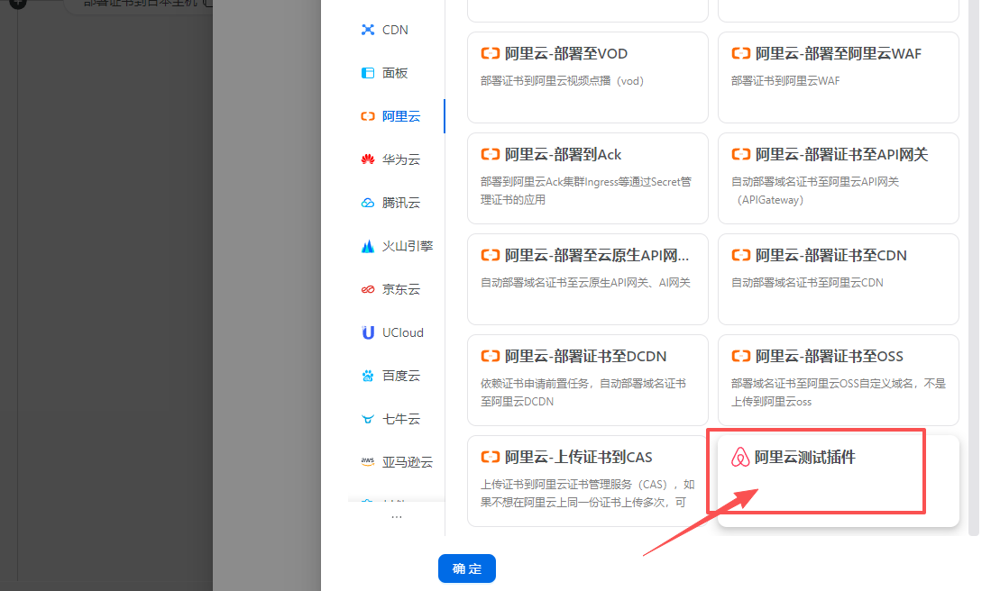
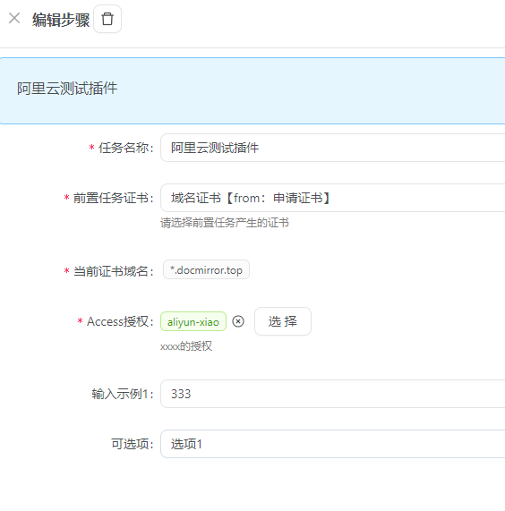
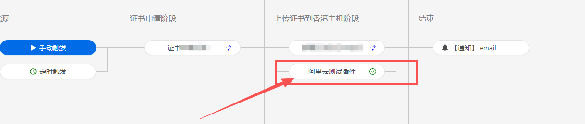

# 插件开发

从「系统管理 → 插件管理」进入。已有插件可先在[插件市场](../../plugins/market.md)搜索。

## 插件创建
 点击自定义插件按钮，填写插件基本信息


创建成功后，会默认打开插件编辑页面，里面默认带有示例代码说明，可以在此基础上进行你的自定义开发


## 插件测试
 
 在流水线中添加插件任务


 配置插件任务参数


 点击运行，查看插件任务运行结果


## 使用 AI 开发

1. 在插件管理选择「AI开发插件」，按对话框说明生成开发提示和受限令牌。
2. 在开发工具中说明插件类型、目标 API、授权字段和预期输出。测试时使用专门的授权和流水线。
3. 回到插件管理检查插件配置，运行测试流水线并查看日志。验证成功、缺少授权和目标接口错误三种情况。

## 依赖与旧插件升级

在线插件可配置依赖插件和 npm 包。仅声明实际需要的依赖，安装后在运行日志中确认解析结果。

从 v1.38.0 前升级时，旧版包引用可能已迁移。先检查公开包的现有导出。确实需要引用服务端模块时，从 v1.38.1 起可在在线插件脚本通过 `await _ctx.import("/@/...")` 加载，`/@/` 指向 `certd-server/src`。引用内部模块时在升级后重新验证路径。

```js
const { CertReader } = await _ctx.import("@certd/plugin-lib")
const { AliyunAccess } = await _ctx.import("/@/plugins/plugin-lib/aliyun/access/index.js")
```

从 v1.42.0 起申请任务不再输出 `certZip`。插件只需要部署证书时引用证书对象。需要 ZIP 时，使用 `await new CertReader(cert).buildZip()`。

## 发布到插件市场

在自开发插件的发布入口检查作者、插件名称和版本号，补充使用说明后提交。发布先经过 AI 安全审查，再等待管理员审核。可在发布管理查看版本、状态和驳回原因，修订后提升版本再提交。
