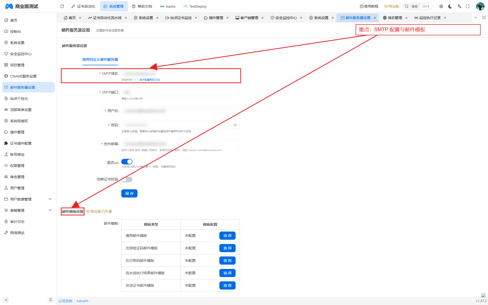
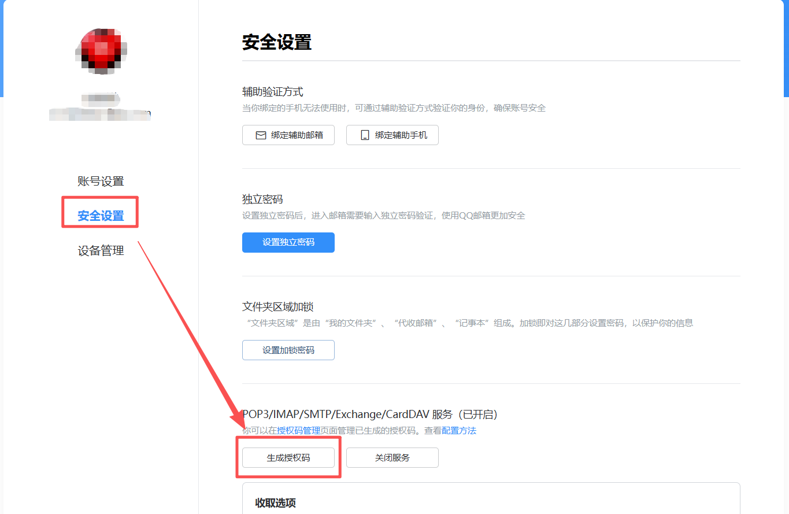

# 邮箱配置

Certd 使用邮件服务器发送验证码、找回密码邮件、流水线通知和证书邮件。管理员在「系统管理 → 邮件服务器设置」完成站点配置。

## 配置并发送测试邮件

1. 选择「使用自定义邮件服务器」，按邮件服务商要求填写 SMTP 域名、端口、用户名和密码。部分邮箱需要在邮箱后台开启 SMTP，使用单独生成的授权码。
2. 填写服务商允许的发件邮箱。需要显示名称时可填写 `Certd 通知<certd@example.com>`。SSL 开关用于连接开始时即启用 TLS 的 SMTP 配置，例如使用服务商指定的 465 端口。
3. 保存，在下方的测试区域填写收件地址并发送。确认收件箱收到邮件后，再为流水线或站点监控选择邮件通知。



## 自定义邮件模板

具备专业版权益时，在同一页面的「邮件模板设置」为通用邮件、流水线执行结果、注册验证码、找回密码和发送证书选择对应模板。模板编辑界面提供该类邮件可用的字段。保存后用代表性操作验证，测试邮件可确认 SMTP 连通，验证码、流水线结果和附件则在各自操作中核对。「发送证书到邮箱」任务使用站点的发送证书邮件模板。

## 发送失败

- 认证失败时核对 SMTP 已启用、用户名为服务商要求的账号、密码为有效授权码。
- 连接超时时，在 Certd 的「网络测试」检查 SMTP 主机和端口是否可达。容器环境需以容器的网络结果为准。
- TLS 校验失败时核对 SMTP 域名、端口和证书链。使用可信证书可保持校验开启。
- 测试成功但通知未到时，在流水线确认通知开启且事件匹配，检查任务记录、收件地址和垃圾邮件。

## 腾讯企业邮箱配置
1. 开启smtp     
<!-- 邮箱配置截图占位：腾讯企业邮箱 SMTP 开关 -->

2. 获取授权码作为密码      
<!-- 邮箱配置截图占位：腾讯企业邮箱 SMTP 授权码 -->

<!-- 邮箱配置截图占位：腾讯企业邮箱授权码安全提示 -->

3. 填写域名、端口和密码        
<!-- 邮箱配置截图占位：Certd SMTP 表单示例 -->


## QQ邮箱配置
1. smtp配置
```yaml
smtp域名: smtp.qq.com
smtp端口: 465
密码: 授权码，获取方式见下方
是否SSL: 是
```

2. 获取授权码    
登录qq邮箱，点击账号与安全   

<!-- 邮箱配置截图占位：QQ 邮箱 SMTP 授权码入口 -->
   
