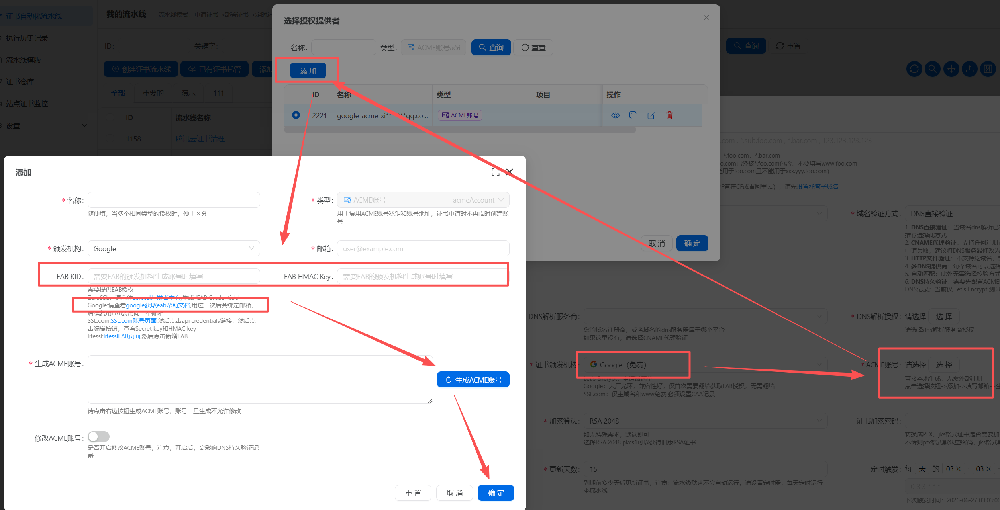

# Google 证书申请

申请 Google 证书前，先获取 EAB 凭据并在 Certd 中生成 Google ACME 账号。申请任务可使用 DNS 直接验证或 DNS 持久验证。

## 获取 Google EAB

1. 在 Google Cloud 控制台选择项目，启用 [Public Certificate Authority API](https://console.cloud.google.com/apis/library/publicca.googleapis.com)。
2. 在该项目的 Cloud Shell 执行命令，按提示授权。

   ```sh
   gcloud publicca external-account-keys create
   ```

3. 保存返回的 `keyId` 和 `b64MacKey`，复制时排除输出末尾的括号。

如果命令执行失败，先检查 Cloud Shell 选中的项目、API 状态以及账号是否有生成 EAB 的权限。新 EAB 须在 7 天内用于注册，已注册的 ACME 账号可继续使用。[Google Cloud 官方步骤](https://docs.cloud.google.com/certificate-manager/docs/public-ca-tutorial?hl=zh-CN)

## 生成 ACME 账号

1. 在 Certd 打开 **设置 → 授权管理**，新增 **ACME账号** 授权。
2. 颁发机构选 **Google**，填写邮箱。把 `keyId` 填到 **EAB KID**，把 `b64MacKey` 填到 **EAB HMAC Key**。
3. 点击 **生成ACME账号**，然后保存授权。回到证书申请任务，颁发机构选 **Google**，并选择这个账号。



遇到 `Unknown external account binding` 时，检查 EAB 是否输错、已使用或过期。重新申请 EAB 并生成账号后，保存授权再重试。已有有效 ACME 账号可直接复用。

## DNS 持久验证

DNS 持久验证使用与 Google ACME 账号绑定的长期 TXT 记录。只要账号和记录仍有效，续期时可以复用这条记录。

1. 在证书申请任务选择 **Google** 和对应的 **ACME账号**，验证方式选 **DNS 持久验证**。如果列表还没有对应记录，先在 **设置 → DNS持久验证记录** 新增，填写域名并选择同一个账号。
2. 在验证计划中点击 **设置TXT**。可以选择 DNS 服务商和授权让 Certd 自动创建，也可以在 DNS 控制台手动复制表单给出的 TXT 主机名和完整值。记录名前缀是 `_validation-persist`。
3. 手动添加后点击 **校验**。自动创建可以等待后台校验，也可手动检查。确认状态变为 **有效**，再保存流水线并运行。
4. 保留 TXT 供后续续期。更换 ACME 账号后，使用新账号生成对应记录并重新校验。

如果校验迟迟不成功，核对 TXT 是否写入正确的权威 DNS 区域，以及控制台是否重复附加了域名。任务提示 CA 不支持 `dns-persist-01` 时，可为该证书改用 [DNS 直接验证](../cert/validation.md#dns-直接验证)。
