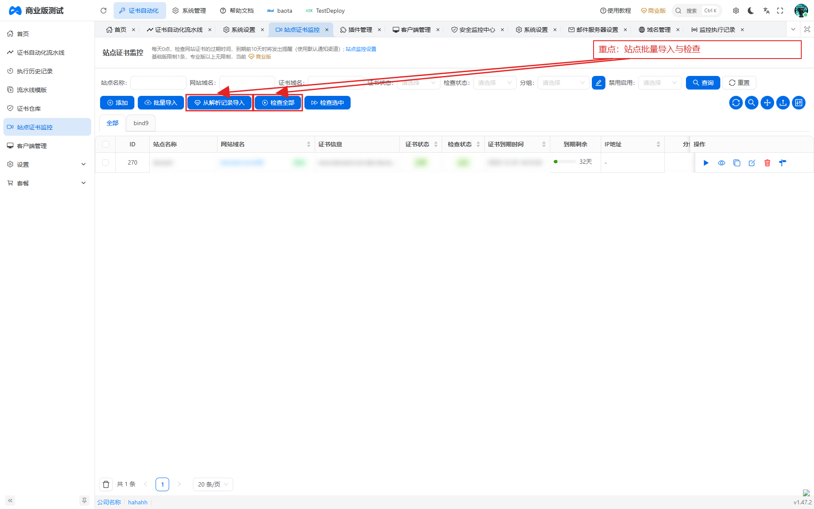
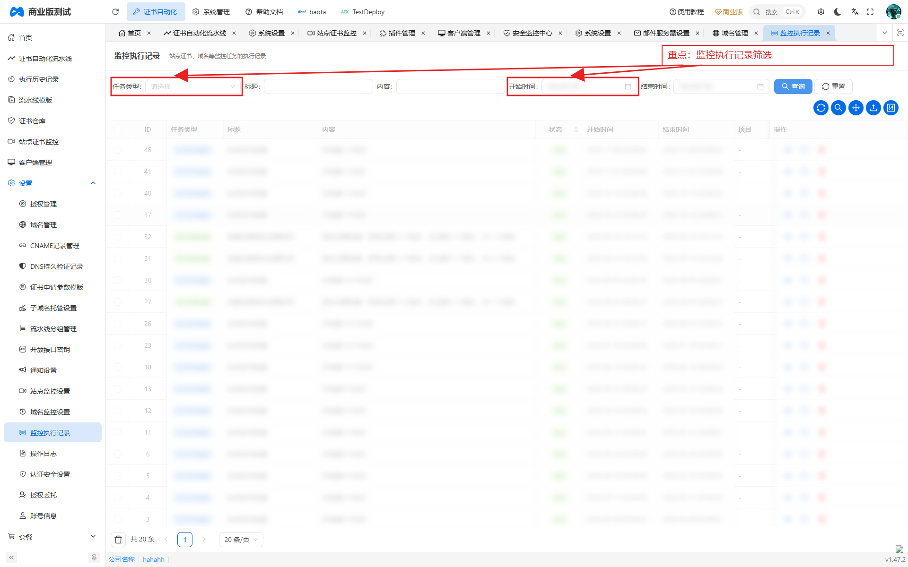

# 站点与域名监控

站点证书监控检查服务实际提供的 TLS 证书。域名到期监控检查注册域名的到期日。证书更新与域名续费分别处理。

## 检查站点证书

1. 打开「站点证书监控」，填写站点名、域名和 HTTPS 端口，默认使用 443。创建证书流水线时也可勾选加入监控，此入口需要专业版并在系统流水线设置中启用。
2. 点击「立即检查」，查看证书的颁发机构、覆盖域名、有效期和检查状态。
3. 在监控设置中设置提前提醒天数、检查计划和通知渠道。用「监控执行记录」确认计划检查结果。

### 批量添加与指定 IP

- 在「批量导入」中每行填写一个站点，例如 `www.example.com:443:官网:生产环境`，依次为域名、端口、名称和备注。只填域名时默认使用 443 端口，也可给本批次选择分组。
- 使用「从域名提供商导入」时，选择提供商和有权读取域名与解析记录的授权，保存并运行导入任务。阿里云、腾讯云、华为云 DNS 和 Cloudflare 支持读取解析记录。导入会跳过已有站点、泛域名、ACME 验证记录和 TXT 等非站点记录。导入后查看成功、跳过和失败统计。
- 按站点名称、域名或分组筛选列表后可导出，也可勾选站点批量检查。使用「IP 管理」检查某个节点时，保留站点域名以便校验证书。只希望检查手动维护的 IP 时，可关闭自动同步。
- 默认会报告节点证书与主站证书的到期时间不一致。允许节点更新节奏不同的场景，可开启「忽略证书一致性」，仍会检查证书到期。

\n\n## 监控域名注册到期

1. 打开「域名管理」，添加或从 DNS 提供商导入域名，再同步到期时间。列表可查看同步进度、备注，并按到期时间排序。
2. 专业版可打开域名到期监控设置，配置提前天数、检查计划和通知渠道。
3. 在「监控执行记录」选择「域名到期检查」。遇到即将到期或已过期的域名，到注册商续费，再同步到期时间。

## 没收到提醒或检查失败

- **连接超时。** 从 Certd 所在主机或容器检查 DNS 和 HTTPS 端口是否可达。代理或负载均衡场景可用指定 IP 检查定位节点。
- **没收到到期提醒。** 对照监控执行时间、剩余天数和通知渠道设置。站点证书与域名注册的提醒配置分别保存。
- **管理员需要查看用户资源。** 在「系统管理 → 用户数据管理」查询用户流水线或站点监控。需要查看或下载用户证书时，请用户在个人资料开启授权委托。[系统管理页面](../setting/admin.md#授权委托)
