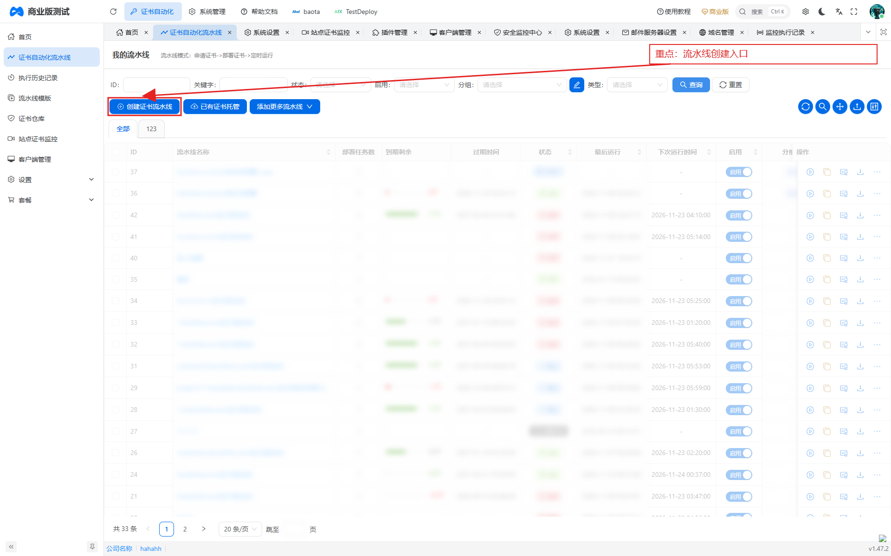

# 流水线

一条流水线把证书来源、部署任务、触发器和通知连在一起。多个部署步骤可引用同一个证书输出。

## 创建并验证

1. 在「流水线」创建证书流水线，输入要覆盖的域名，选择证书来源和验证方式。[证书申请与托管](../cert/)
2. 添加部署任务，选择目标授权，证书输入选择上游任务的「域名证书」输出。
3. 保存并运行一次。在运行历史中打开失败步骤的日志，并到部署目标确认新证书已经生效。
4. 添加定时触发器，设置成功和失败通知。到期前更新天数决定何时申请新证书，定时触发器决定何时检查。

## 复用申请参数

在「设置 → 证书申请参数模版」新增模板，配置颁发机构、账号和续期参数。设为默认后，创建证书流水线时会自动载入，也可在表单切换。域名和校验方式在创建流水线时另行填写。批量修改已有流水线时，在列表勾选目标后使用批量修改申请参数或成功通知。

## 编辑步骤和导出列表



- 专业版支持复制任务步骤。在流水线编辑器打开任务，点击单个步骤旁的「复制」，或点击「任务步骤」旁的「复制」来复制该任务的全部步骤。打开目标任务，点击「粘贴」。粘贴后检查步骤引用的上游输出、授权和目标，再保存运行。任务内步骤按顺序执行，前一步失败后，后续步骤停止执行。
- 盘点流水线时，先在列表按分组或状态筛选，再点击表格工具栏的导出按钮。导出按当前搜索条件读取列表数据，适用于汇总域名、有效期和运行状态。要复用任务配置，可用流水线行菜单的复制功能，或在「流水线模板」选择现有流水线作为配置来源。

## 定时、Webhook 与批量运行

<!-- 截图占位：流水线触发器设置和 Webhook 地址区域，遮盖实际触发地址。 -->

- 定时触发可按界面配置或使用 Cron。从流水线模板创建时可选择随机分配时间。批量设置定时也可随机分配，或清除原来的定时。保存后可在流水线列表和详情查看下次执行时间。定时流水线按用户排队，默认同时执行 10 条，在「系统设置 → 流水线设置」可调整。
- 在流水线编辑器添加 Webhook 触发器，保存后复制地址。每条流水线可配置一个地址，支持 GET 和 POST。调用后打开运行历史确认触发结果。地址带有调用凭据，应仅交给受信任的调用方。重新生成后旧地址失效。
- 日常排程用普通运行。需要重试已成功或已跳过的步骤时使用强制重新运行，并先确认重新部署的影响。列表可对所选流水线批量运行。[强制重新执行](../rerun/)
- Webhook 触发器接收外部请求并启动运行。要向外部服务发送运行结果，在通知渠道中配置 Webhook。要把证书传给部署目标，添加下文的部署任务。

## 通过 Webhook 部署证书

接收系统提供证书更新接口时，在证书任务后添加「webhook方式部署证书」，证书输入选择上游的「域名证书」。例如，将请求地址设为 `https://deploy.example.com/api/cert`，方法选 `POST`，内容类型选 `application/json`。如果接收端使用 Bearer Token，在「Headers」填写 `Authorization=Bearer YOUR_TOKEN`，每行一个请求头。

在「消息body模版」中按接收端要求填写字段。例如，接收端可从 `certificate` 和 `privateKey` 字段读取 PEM 证书和私钥。

```json
{
  "certificate": "${crt}",
  "privateKey": "${key}"
}
```

保存后用受信任的 HTTPS 测试接收端试运行，检查接口响应和部署结果。请求中含有私钥，测试时也要避免在接收端记录请求体。

## 后置任务与吊销

流水线编辑器底部可添加后置任务，并选择在主体成功、失败或手动标记成功时运行。成功或失败通知在后置任务完成后发送。后置任务失败会使流水线整体失败，原因可在运行历史中查看。

「吊销旧证书」可配置在成功后运行，处理同一申请任务产生的已替换证书。需要实际向 CA 发起吊销时，开启「吊销未激活的旧证书」。可配置等待时间，以便先确认新证书已经生效。启用前检查是否还有其他服务使用旧证书。

## 常见问题

- **运行成功但没有更新。** 检查证书剩余有效期。尚未进入更新窗口时，申请步骤可以复用上次证书。再查看部署任务的跳过原因。
- **手动执行成功，定时没有执行。** 检查流水线是否启用、触发器保存后的下次执行时间，以及[流水线有效期](./valid.md)。
- **历史记录太多。** 在流水线设置中调整历史保留数量。新建流水线默认保留 100 条。
