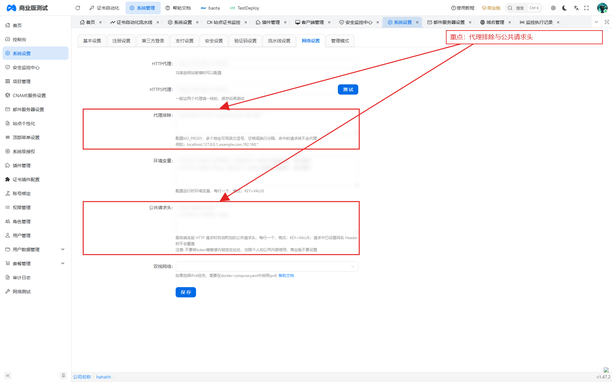

# 网络设置与健康检查

Certd 的证书申请、DNS 验证和部署任务从服务端访问外部服务。排查时，先确认失败的是浏览器访问 Certd，还是 Certd 访问部署目标。

## 测试从 Certd 到目标的连通性

1. 打开「系统管理 → 网络测试」，查看 Certd 服务所在环境的接口地址和 DNS 服务器。
2. 对目标域名运行域名解析，核对返回的地址。遇到多 IP 时，确认实际部署和验证使用的地址。
3. 使用 TCP 端口测试检查目标端口，例如 HTTPS 的 443 或 SSH 的 22。Ping 可帮助判断网络可达性，服务端口仍需单独测试。
4. 端口可连接但任务失败时，查看任务日志中的 HTTP 状态、TLS 错误或认证提示，再检查对应授权与代理配置。

在 Docker 部署中，网络测试反映容器环境。宿主机能访问目标时，也需要检查容器的 DNS、路由和目标服务的 IP 白名单。

## 配置出站代理



在「系统管理 → 系统设置 → 网络设置」填写 HTTP 代理或 HTTPS 代理，保存后重试原任务。使用「代理排除」配置 `NO_PROXY`，多个值使用英文逗号、空格或换行分隔，例如 `localhost,127.0.0.1,.example.com`。域名匹配后直接连接目标。私有 CA、内网 DNS 服务或只接受内网来源的部署目标可按实际地址配置排除。

「公共请求头」每行填写一个 `KEY=VALUE`，Certd 的 HTTP 请求工具会将其附加到请求，已有同名请求头时保留任务设置。公共请求头会发往多个目标，Token、Cookie 和 API 密钥应填写在各插件自己的授权中。

## 反向代理与来源 IP

将 Certd 放在 Nginx 等反向代理后面时，使用 HTTPS 对外提供站点，并使 Certd 的后端端口仅对可信代理开放。在入口代理设置由代理确认的客户端地址，覆盖外部传入的转发请求头。部署后，从已知来源 IP 登录，在审计日志或安全监控中比对记录的 IP。来源 IP 全部显示为代理地址时，检查转发头和代理链配置，再使用 IP 封禁规则。[站点安全](../../feature/safe/)

## 健康检查

Certd 提供两个 HTTP GET 路径，路径中的 `liveliness` 是实际拼写。

- `/health/liveliness` 检查应用进程能否响应 HTTP。
- `/health/readiness` 可作为就绪探针。当前实现也只返回应用响应，无数据库或外部服务检查。

Docker Compose 可以在 `certd` 服务下配置健康检查。以下示例使用镜像中的 Node.js，端口为容器内默认的 HTTP 端口。

```yaml
healthcheck:
  test: ["CMD", "node", "-e", "fetch('http://127.0.0.1:7001/health/liveliness').then(r => { if (!r.ok) process.exit(1) }).catch(() => process.exit(1))"]
  interval: 30s
  timeout: 5s
  retries: 3
  start_period: 30s
```

Kubernetes 可分别设置：

```yaml
livenessProbe:
  httpGet:
    path: /health/liveliness
    port: 7001
readinessProbe:
  httpGet:
    path: /health/readiness
    port: 7001
```

探针失败时，先核对容器内监听端口和 HTTP／HTTPS 协议，再查看应用启动日志。如果服务绑定了特定地址，也要确认探针能访问该地址。
