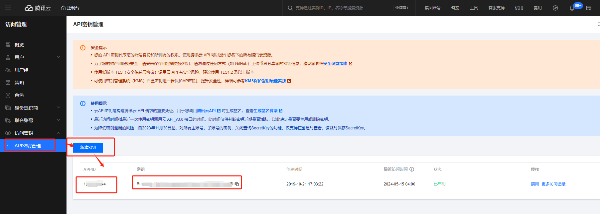

# 腾讯云

## 腾讯云API密钥设置

腾讯云其他部署需要API密钥，需要在腾讯云控制台进行设置   
打开 https://console.cloud.tencent.com/cam/capi   
然后按如下方式获取腾讯云的API密钥    

## 如何避免收到腾讯云证书过期邮件

在「腾讯云授权」中可以设置「关闭证书过期通知」。如果依赖腾讯云自身的到期提醒，请关闭该选项。使用腾讯云国际站时，在授权中选择「国际站」，并测试授权是否可用。

需要清理已替换的证书时，可配置「腾讯云-删除即将过期证书」任务。先确认旧证书已从需要继续服务的资源解绑。

注意点：
> 1. 选择腾讯云授权，需授权`服务角色SSL_QCSLinkedRoleInReplaceLoadCertificate`权限
> 2. `1.26.14`版本之前Certd创建的证书流水线默认是到期前20天才更新证书，需要将之前创建的证书申请任务的更新天数修改为35天，保证删除之前就已经替换掉即将过期证书

## 证书部署选项

- **CLB**：按地域选择负载均衡、HTTPS 监听器和域名。SNI 开启时选目标域名；SNI 未开启时域名可留空。要部署域名级证书，目标监听器需开启 SNI。
- **CDN**：优先使用「腾讯云-部署到CDN-v2」，支持 CDN 域名及 COS 加速域名。旧版「部署到CDN」已经废弃。
- **TKE**：证书类型为 Nginx TLS 时，使用证书申请任务输出；选择 qcloud Opaque/CLB 格式时，先添加「上传证书到腾讯云」任务，并把输出证书 ID 传给部署任务。Serverless 集群使用通用 K8S 插件。Certd 必须能连接集群 API Server；填写「集群域名」可覆盖默认地址。需要重启 Ingress 时填写 Ingress 名称。
- **腾讯云国际站**：在腾讯云授权中选择「国际站」，保存后点击测试。部署任务仍需选择资源实际所在地域。

权限不足时，按目标服务补开腾讯云 CAM 权限。TKE Secrets 报 API 鉴权错误时，还要检查该集群用户或角色是否有目标命名空间的 Secret 读取和更新权限。

## TKE service 的 TCP_SSL Opaque类型证书授权

部署证书到腾讯云TKE，如果报以下错误：     
`is forbidden: User "xxxxxx-xxxxx" cannot get resource "secrets" in API group "" in the namespace "default"'`     
则需要单独从授权管理侧再授权子用户的权限

